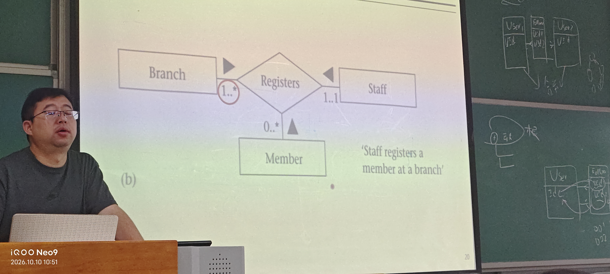
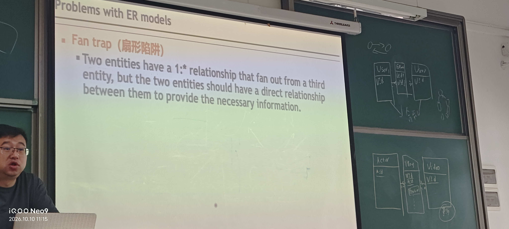

2NF:不存在主键的一部分决定其他非键字段

3NF:不存在非键字段确定其他非键字段

BCNF:不存在非键字段确定主键的一部分

4NF:在全键表当中，至多存在一个多值依赖

递归关系：
- 一对多：选项展开
- 多对多：账号互关

55 
当其他实体取值固定时，你的取值范围

**连接陷阱**：误认为不存在联系的两个实体之间存在联系
- 扇形陷阱：
- 深坑陷阱：

**超类与子类**
- 分离规则：超类的一个实例至多属于一个子类类别，指示器可以单字段
- 交叠规则：一个超类实例可能属于，指示器不可以为空，指示器多字段
- 局部特殊化：超类的某些实例不属于任何子类类型，用“-”表示
- 全局特殊化：超类的所有实例都必须至少属于一个子类类别，用“=”表示

**physic database design**

denormalization（反规范化）：
- 反规范化要适度
- 要考虑读写比例

**Partitioning table**
- Horizontal:表的记录根据业务逻辑分开存储，减少顺序扫描时的
- Vertical:表结构不一致，增加一次IO能检索的数据条数
